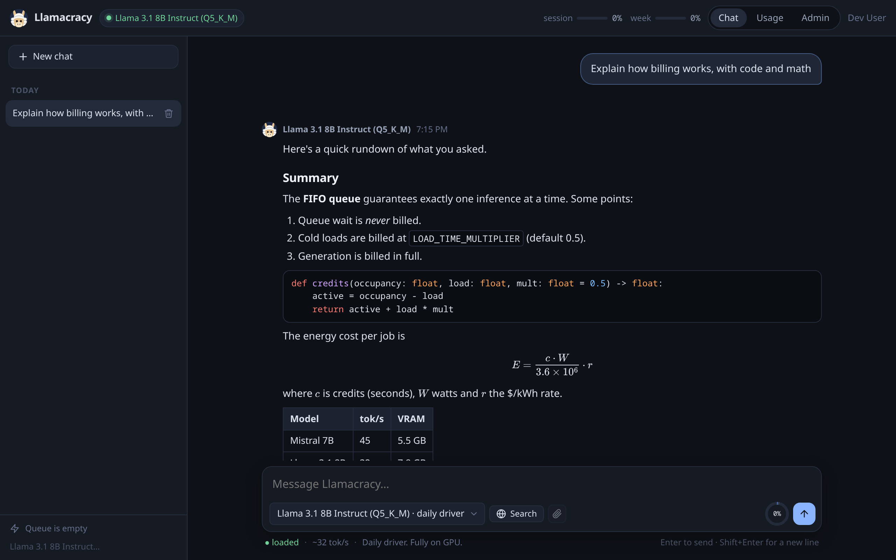

<p align="center">
  
</p>

<h1 align="center">Llamacracy</h1>

<p align="center">
  A self-hosted, multi-model LLM chat hub for you and a few friends.<br>
  One GPU, a strict FIFO queue, per-person credits, and an admin dashboard that knows what everyone's usage costs in electricity.
</p>

<p align="center">
  <a href="https://github.com/jdankney/Llamacracy/actions/workflows/tests.yml"></a>
  <a href="LICENSE"></a>
</p>

<p align="center">
  
</p>

Llamacracy turns one box with a consumer GPU into a private "ChatGPT for the
group chat". Friends sign in over a private network, pick a local GGUF model,
and take turns on the GPU. Every second it spends on someone is measured and
charged to them as a credit, so one heavy user can't monopolise the machine.

It's deliberately small: FastAPI, SQLite, a vanilla-JS front end with no
build step, and [llama-swap](https://github.com/mostlygeek/llama-swap) for
loading models. No cloud APIs, no Docker for the app itself.

## Features

**Chat**

- Streaming markdown, highlighted code and KaTeX math (rendered as it
  streams), with a ring showing how full the context is before you send.
- A model picker with per-model defaults and "loaded / cold start ~4s" hints.
- **Think** toggle for models that can reason; the reasoning streams live and
  folds away afterwards.
- Edit any message you sent: the conversation forks, and `‹ 1 / 2 ›` arrows
  flip between versions.
- Attach documents (PDF, Word, LibreOffice, Excel, PowerPoint, text, CSV,
  code) on any model, and photos on models with vision.
- Retry any reply, on the same model or another, and keep both answers.
  Stop keeps what was written so far.
- Search your chats by title or by anything said in them, rename them, and
  download one as Markdown.
- Fold a long conversation's older part into a summary on request.
- Chats name themselves after the first reply, and every message shows its
  date and time.

**Tools**, for models marked `"tools": true`

- **Search**: the model writes its own queries, opens the pages it needs and
  cites numbered sources, with a live trail of each step. Other models get
  one search added to the message.
- **Files**: the model writes drafts, plans, CSV or code to the chat's
  workspace and edits them in place. Files fork with the conversation.
- **`run_python`**: the model calculates and draws with code instead of in
  its head (sympy, numpy, scipy, pandas, matplotlib, seaborn, schemdraw and
  more), in a bubblewrap sandbox with no network. It can read the chat's
  spreadsheets and photos, and the charts it makes appear under the reply.
- **Checks**: the server flags numbers in an answer that didn't come from
  the code's output, and quotations that aren't word for word in what the
  model read.

**Study** (`/study`)

- Each person adds their own courses, with materials (syllabus, notes,
  slides, old exams). The tutor asks before it tells, and says which file and
  page it used.
- Five modes: Guide me, Explain, Check my work, Quiz me and Practice.
  Practice problems come with keys that are computed or quoted and then
  checked, and answers are graded by the server.

**Sharing one GPU**

- A strict FIFO queue, one inference at a time, visible to everyone.
  Cancelling really aborts, and an idle timeout frees VRAM, unless an admin
  has locked a model in.
- `1 credit = 1 second of GPU time`, measured, never estimated. Rolling
  5-hour and 7-day limits, with per-user overrides.
- The cost model uses measured GPU watts and your electricity tariff,
  time-of-use included.

**Around the app**

- An admin dashboard: live GPU stats, users, per-model performance, queue
  fairness, billing with draft invoices and CSV export.
- An account page per user: a name and a few lines about themselves for the
  models, themes and text size, a usage chart and API keys.
- An OpenAI-compatible `/v1` endpoint for IDE tools, on the same queue and
  limits. There's a [Continue config](examples/continue/) ready to use.
- Installable as a PWA on phones.

## How it works

```
 browser ──HTTP over NetBird──▶ oauth2-proxy ──▶ FastAPI app ──▶ llama-swap ──▶ llama-server
                                     │              │  ▲               (one model resident)
                                     ▼              ▼  │
                                    Dex           SQLite (WAL)
                              (users + passwords)  jobs · credits · chats
```

- **Identity** comes from oauth2-proxy's headers; the app has no login code
  of its own and refuses to serve without them (outside `DEV_MODE`).
- **The queue** (`llamacracy/queue.py`) drains jobs in order, streams tokens
  over SSE, and runs the tool loop as one job.
- **Models** are declared once in `bench/inventory.json`; a generator turns
  that into the llama-swap config and the app's model list.

Nothing about your machine is committed. Your models, measurements,
secrets and hostname live in gitignored files that the installer creates
from committed examples.

## Requirements

- Linux, Python 3.14+ and [uv](https://docs.astral.sh/uv/).
- [llama.cpp](https://github.com/ggml-org/llama.cpp)'s `llama-server`,
  [llama-swap](https://github.com/mostlygeek/llama-swap), and GGUF models.
- An NVIDIA GPU for measured power (`nvidia-smi`); without one, costs use a
  per-model estimate.

Optional:

| For | You need |
| --- | --- |
| Search | A [SearXNG](https://docs.searxng.org) instance (`SEARXNG_URL`) |
| `run_python` | [bubblewrap](https://github.com/containers/bubblewrap) and util-linux's `prlimit`; librsvg's `rsvg-convert` for SVG pictures |
| Friends signing in | [NetBird](https://netbird.io) (or any private network) and Docker for Dex; the installer fetches oauth2-proxy |

Developed on a GTX 1080 Ti (11 GB) with 32 GB RAM. The benchmark measures
what your card can actually serve.

## Quick start (single user, no auth)

```bash
git clone https://github.com/jdankney/Llamacracy && cd Llamacracy
uv sync

cp bench/inventory.example.json bench/inventory.json
$EDITOR bench/inventory.json              # your models
python3 bench/gen_llamaswap_config.py     # writes config/

cp .env.example .env
$EDITOR .env                              # DEV_MODE=1, ADMIN_EMAILS=dev@localhost

llama-swap -config config/llama-swap.yaml -listen 127.0.0.1:8091 &
uv run uvicorn llamacracy.app:app --host 127.0.0.1 --port 8000
```

Open <http://127.0.0.1:8000>. In dev mode you're signed in as `DEV_EMAIL`,
and listing it in `ADMIN_EMAILS` shows the admin dashboard.
`./deploy/setup-sandbox.sh` builds the sandbox `run_python` needs.

## Models

Each model is one entry in `bench/inventory.json`:

```json
"llama31-8b": {
  "display": "Llama 3.1 8B Instruct (Q5_K_M)",
  "path": "Llama-3.1-8B-Instruct/Llama-3.1-8B-Instruct-Q5_K_M.gguf",
  "tier": "daily",
  "blurb": "Daily driver. Fully on GPU.",
  "tools": true,
  "sampling": { "temperature": 0.6, "top_p": 0.9 },
  "serve": { "ctx": 65536, "kv_type": "q8_0", "args": ["-b", "2048", "-ub", "512"] },
  "seed": { "cold_load_s": 4, "tg_tok_s": 32, "pp_tok_s": 700, "vram_used_mib": 7800 }
}
```

`seed` holds rough numbers the app uses until you benchmark. Add
`"thinking": true` for the Think toggle, or a `vision` block with an
`mmproj` path for images. The full schema is in
[bench/README.md](bench/README.md).

After any change, regenerate and restart:

```bash
python3 bench/phase0_bench.py --only llama31-8b    # optional: measure load time, tok/s, VRAM, watts
python3 bench/gen_llamaswap_config.py
systemctl --user restart llamacracy               # llama-swap reloads its config by itself
```

## Running it for friends

```bash
netbird up                                     # join your NetBird network
./deploy/install.sh                            # local files, secrets, sandbox, systemd units
$EDITOR bench/inventory.json && python3 bench/gen_llamaswap_config.py
$EDITOR .env                                   # ADMIN_EMAILS, electricity rate
cd deploy/dex && ./gen-hash.sh                # asks for a password; one staticPasswords entry per user in config.yaml
cd ../.. && llamacracy restart && llamacracy status
```

The installer finds your NetBird FQDN, wires Dex and oauth2-proxy to it, and
installs four systemd user units, which `llamacracy up|down|restart|status|logs`
drives together. Users sign in at `http://<your-fqdn>:4180`.

## Configuration

Every setting is an environment variable, listed with its default in
[`.env.example`](.env.example): credit limits, output caps, electricity rate
or time-of-use table, idle timeout, search, tools, uploads and Study.
Per-user limits are set from the admin dashboard.

## Documentation

| | |
| --- | --- |
| [deploy/OPERATIONS.md](deploy/OPERATIONS.md) | Running it day to day: services, logs, backups, users |
| [bench/README.md](bench/README.md) | The model inventory, benchmark and config generator |
| [deploy/dex/README.md](deploy/dex/README.md) | Accounts and the identity provider |
| [docs/WELCOME.md](docs/WELCOME.md) | A template for the note you send new users |
| [docs/DECISIONS.md](docs/DECISIONS.md) | Why things are the way they are |
| [docs/SPEC.md](docs/SPEC.md) | The original brief |
| [CHANGELOG.md](CHANGELOG.md) | What changed in each release, and how to upgrade |

## License

[AGPL-3.0-or-later](LICENSE). You can use, study, change and share it. If you
run a modified version as a service that other people use over a network,
you must offer those users its source code under the same license. Running
it unmodified, or changing it only for yourself, asks nothing of you.
